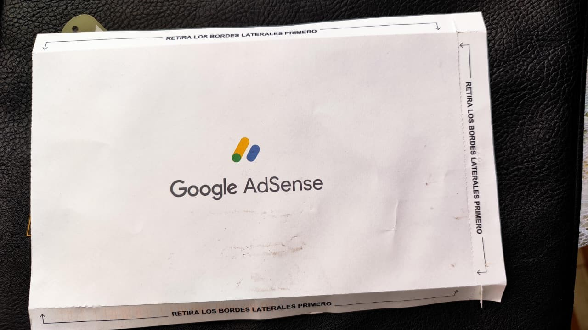

# ¿Cuánto tarda en llegar el PIN de AdSense a Puno, Perú?

Experiencia real, por si te sirve mientras esperas el tuyo.

## Resumen

- **Ciudad:** Puno, Perú.
- **Envíos:** pedí la verificación de dirección **dos veces**, y el sobre que llegó fue **el del primer envío**.
- **Tiempo:** la verificación ya figuraba pedida el **14 de octubre de 2026** y el sobre llegó el **18 de noviembre de 2026**: **unos 35 días como mínimo**, por correo postal normal.

## Cómo es el sobre

Es un sobre blanco que dice «Google AdSense». Se abre **retirando primero los bordes laterales** y luego desplegándolo; adentro está el PIN.

## Dónde se ingresa el PIN

En AdSense: **Pagos → Información de pagos → Verificar dirección**. Hay pocos intentos, así que escríbelo con cuidado.

## Consejo

Si vives en provincia, espera **al menos 5 semanas** antes de pedir otro PIN. Pedir uno nuevo no hace que llegue antes, y puede que te llegue primero el sobre viejo, como me pasó a mí.
